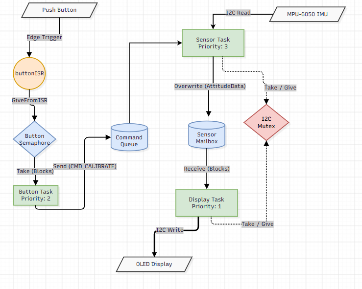

# ESP32-S3 FreeRTOS Project: Horizon32

## 1. Project Overview
An artificial horizon flight display indicating pitch and roll using a MPU6050 IMU and an I2C OLED 

## 2. Hardware and Usage
### Components Used
* ESP32-S3-Wroom-1 
* Fermion SSD1306 OLED Display
* Adafruit MPU6050 IMU
* Standard pushbutton 

### How to Use the System
1. Power the ESP32
2. Observe display
3. Hold button for 1 second and let go to calibrate if horizon does not match your standards

---

## 3. FreeRTOS Architecture

### Task Diagram

### Tasks and Priorities
The system utilizes the following FreeRTOS tasks:

1. **[SensorTask]**
   * **Responsibility:** Interacting with sensor and managing sensor values (Could be split into separate calibrate task)
   * **Priority:** 3
   * **Priority Justification:** Needs strict timing to read sensors without missing readings.

2. **[DisplayTask]**
   * **Responsibility:** Draws display
   * **Priority:** 1 
   * **Priority Justification:** UI updates rely on data from other tasks

3. **[ButtonTask]**
   * **Responsibility:** Interacts with user input
   * **Priority:** 2 
   * **Priority Justification:** Sensor task should not be preempted because it could alter physics calculations. Display task should not preempt the button because it could cause the button to wait for draws which take much longer than sensor task runs.

### Communication & Synchronization
* **Queues:** 
  * [sensorMailbox]: Used to send AttitudeData struct from sensor task to display task.
  * [commandQueue]: Used to send system command enum from button task to sensor task.
* **Mutexes (Shared Resources):**
  * [i2cMutex]: Used to protect the I2C bus so that multiple tasks do not attempt to write to it simultaneously.
---

## 4. Source Code and Compilation
### Repository Structure
* `/src` - Contains the main `.cpp` and `.h` files.
* `/docs` - Contains diagrams and presentation materials.

### How to Build and Flash
1. Open the project in [PlatformIO / Arduino IDE].
2. Ensure the board is set to **ESP32-S3**.
3. Install required libraries: [Arduino, Adafruit MPU6050, Olikraus/U8g2].
4. Compile and upload to the board.